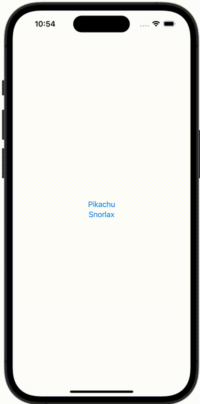

+++
title = "SwiftUIでAlertを出し分ける"
url = "2023-10-15"
date = "2023-10-15"
description = "SwiftUIでAlertを出し分ける"
tags = ["Swift", "SwiftUI"]
categories = ["SwiftUI"]
archives = "2023/10"
+++

<br>

SwiftUIでAlertを出し分ける方法です。
ボタン1が押されたらアラート1を、ボタン2が押されたらアラート2を表示してください



<!--more-->

**AlertItem.swift**

```swift
import Foundation

struct AlertItem {
    let buttonTitle: String
    let message: String
}
```


**ContentView.swift**

```swift
import SwiftUI

struct ContentView: View {
    @State var showingAlert = false
    @State var alertItem: AlertItem?

    var body: some View {
        VStack {
            Button {
                alertItem = AlertItem(buttonTitle: "Pikachu", message: "Pikachu is a fictional species in the Pokémon media franchise. ")
                showingAlert = true
            } label: {
                Text("Pikachu")
            }

            Button {
                alertItem = AlertItem(buttonTitle: "Snorlax", message: "Snorlax is most popular Pokémon.")
                showingAlert = true
            } label: {
                Text("Snorlax")
            }
        }
        .alert("Alert Title", isPresented: $showingAlert, presenting: alertItem) { alertItem in
            Button(alertItem.buttonTitle, role: .none) {
                print(alertItem.buttonTitle)
            }
        } message: { alertItem in
            Text(alertItem.message)
        }
    }
}

#Preview {
    ContentView()
}
```

