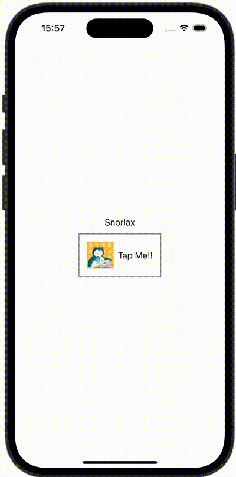

+++
title = "SwiftUIでButton内の画像やテキストの色を変えない"
url = "2023-10-16"
date = "2023-10-16"
description = "SwiftUIでButton内の画像やテキストの色を変えない"
tags = ["Swift", "SwiftUI"]
categories = ["SwiftUI"]
archives = "2023/10"
+++

<br>

SwiftUIでButton内の画像やテキストの色を変えない方法です。
`.buttonStyle(PlainButtonStyle())` を設定することでボタンを押した時の色を変えずに済みます。



<!--more-->

**ContentView.swift**

```swift
import SwiftUI

struct ContentView: View {
    @State var bool = true

    var body: some View {
        VStack {
            Text(bool ? "Snorlax" : "Forever")
            Button(action: {
                bool.toggle()
            }) {
                HStack {
                    Image(.icon)
                        .resizable()
                        .scaledToFill()
                        .frame(width: 50, height: 50)
                    Text("Tap Me!!")
                }
                .padding()
                .border(Color.gray, width: 2)
            }
            .buttonStyle(PlainButtonStyle())
        }
    }
}
```

