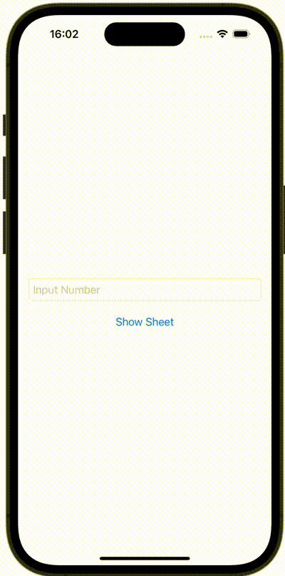

+++
title = "SwiftUIでアラートとシートを出し分ける"
url = "2023-10-17"
date = "2023-10-17"
description = "SwiftUIでアラートとシートを出し分ける"
tags = ["Swift", "SwiftUI"]
categories = ["SwiftUI"]
archives = "2023/10"
+++

<br>

SwiftUIでアラートとシートを出し分ける方法です。
数字が入力されたらシートを表示し、数字以外が入力されたらアラートを表示しています。



<!--more-->

**ContentView.swift**

```swift
import SwiftUI

struct ContentView: View {
    @State var numberString: String = ""
    @State var showingAlert: Bool = false
    @State var showingSheet: Bool = false

    var body: some View {
        VStack {
            TextField("Input Number", text: $numberString)
                .padding()
                .textFieldStyle(RoundedBorderTextFieldStyle())

            Button(action: {
                // Can numberString convert to Double?
                guard Double(numberString) != nil else {
                    showingAlert = true
                    return
                }
                showingSheet = true
            }) {
                Text("Show Sheet")
            }
        }
        .alert(Text("Error"), isPresented: $showingAlert, actions: {
            Button("Close", role: .none) {
                print("Close")
            }
        }, message: {
            Text("Please Input Number")
        })
        .sheet(isPresented: $showingSheet) {
            Text("\(numberString) can convert to Double")
        }
    }
}
```

