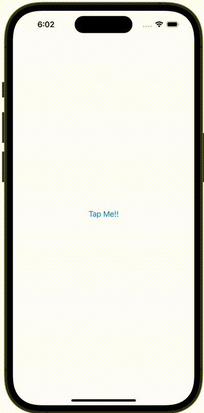

+++
title = "NavigationLinkを使用せずにプッシュ遷移する（.navigationDestination）"
url = "2023-10-18"
date = "2023-10-18"
description = "NavigationLinkを使用せずにプッシュ遷移する（.navigationDestination）"
tags = ["Swift", "SwiftUI"]
categories = ["SwiftUI"]
archives = "2023/10"
+++

<br>

NavigationLinkを使用せずにプッシュ遷移する（.navigationDestination）方法です。



<!--more-->

**ContentView.swift**

```swift
import SwiftUI

struct ContentView: View {
    @State var isActive: Bool = false

    var body: some View {
        NavigationStack {
            VStack {
                Button(action: {
                    isActive = true
                }) {
                    Text("Tap Me!!")
                }
            }
            .navigationDestination(isPresented: $isActive) {
                Text("SecondView")
            }
        }
    }
}

#Preview {
    ContentView()
}
```

