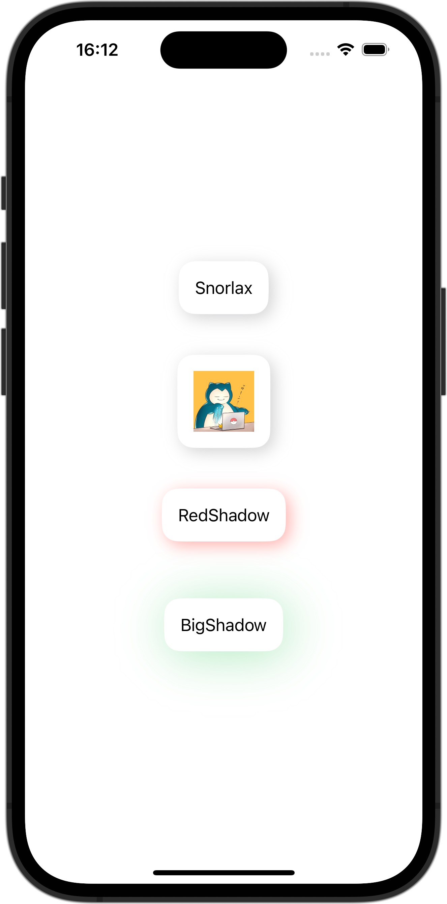

+++
title = "SwiftUIでFunctionBuilderを使ってViewに影をつける"
url = "2023-10-21"
date = "2023-10-21"
description = "SwiftUIでFunctionBuilderを使ってViewに影をつける"
tags = ["Swift", "SwiftUI"]
categories = ["SwiftUI"]
archives = "2023/10"
+++

<br>

SwiftUIでFunctionBuilderを使ってViewに影をつける方法です。
FunctionBuilderを使ってViewに影をつけています。



<!--more-->

**CardView.swift**

```swift
import SwiftUI

struct CardView<Content>: View where Content: View {
    let color: Color
    let radius: CGFloat
    let content: () -> Content

    init(
        color: Color = Color.gray.opacity(0.4),
        radius: CGFloat = 8,
        @ViewBuilder content: @escaping () -> Content) {
        self.content = content
        self.color = color
        self.radius = radius
    }

    var body: some View {
        content()
        .padding(16)
        .background(Color.white)
        .cornerRadius(16)
        .shadow(color: color, radius: radius, x: 4, y: 4)
        .padding(radius + 8)
    }
}
```


**ContentView.swift**

```swift
import SwiftUI

struct ContentView: View {
    var body: some View {
        VStack {
            CardView {
                Text("Snorlax")
            }

            CardView {
                Image(.icon)
                    .resizable()
                    .frame(width: 60, height: 60)
            }

            CardView(color: Color.red.opacity(0.4)) {
                Text("RedShadow")
            }

            CardView(
                color: Color.green.opacity(0.4),
                radius: 24) {
                    Text("BigShadow")
            }
        }
    }
}
```

