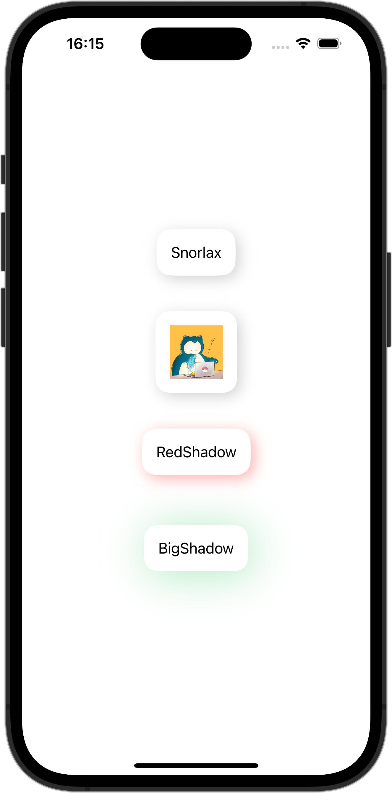

+++
title = "SwiftUIでViewModifierを使ってViewに影をつける"
url = "2023-10-22"
date = "2023-10-22"
description = "SwiftUIでViewModifierを使ってViewに影をつける"
tags = ["Swift", "SwiftUI"]
categories = ["SwiftUI"]
archives = "2023/10"
+++

<br>

SwiftUIでViewModifierを使ってViewに影をつける方法です。
ViewModifierを使ってViewに影をつけています。



<!--more-->

**CardViewModifier.swift**

```swift
import SwiftUI

struct CardViewModifier: ViewModifier {
    let color: Color
    let radius: CGFloat
    func body(content: Content) -> some View {
        content
            .padding(16)
            .background(Color.white)
            .cornerRadius(16)
            .shadow(color: color, radius: radius, x: 4, y: 4)
            .padding(radius + 8)
    }
}
```


**ContentView.swift**

```swift
import SwiftUI

struct ContentView: View {
    var body: some View {
        VStack {
            Text("Snorlax")
                .card()

            Image(.icon)
                .resizable()
                .frame(width: 60, height: 60)
                .card()

            Text("RedShadow")
                .card(color: Color.red.opacity(0.4))

            Text("BigShadow")
                .card(
                    color: Color.green.opacity(0.4),
                    radius: 24)
        }
    }
}
```


**View+Extension.swift**

```swift
import SwiftUI

extension View {
    func card(
        color: Color = Color.gray.opacity(0.4),
        radius: CGFloat = 8) -> some View {
            self.modifier(CardViewModifier(color: color, radius: radius))
        }
}
```

