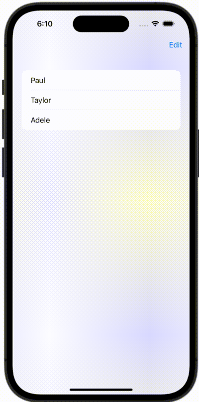

+++
title = "SwiftUIでリストを編集する"
url = "2023-10-23"
date = "2023-10-23"
description = "SwiftUIでリストを編集する"
tags = ["Swift", "SwiftUI"]
categories = ["SwiftUI"]
archives = "2023/10"
+++

<br>

SwiftUIでリストを編集する方法です。



<!--more-->

**ContentView.swift**

```swift
import SwiftUI

struct ContentView: View {
    @State private var users = ["Paul", "Taylor", "Adele"]

    var body: some View {
        NavigationView {
            List {
                ForEach(users, id: \.self) { user in
                    Text(user)
                }
                .onDelete(perform: delete)
            }
            .navigationBarItems(trailing: EditButton())
        }
    }

    func delete(at offsets: IndexSet) {
        users.remove(atOffsets: offsets)
    }
}

#Preview {
    ContentView()
}
```

