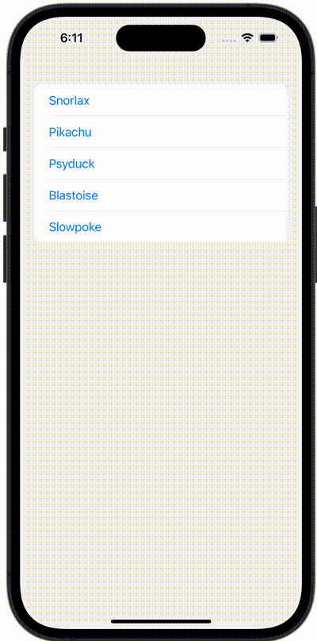

+++
title = "SwiftUIでリストのセルをタップしてアラートを表示させる"
url = "2023-10-24"
date = "2023-10-24"
description = "SwiftUIでリストのセルをタップしてアラートを表示させる"
tags = ["Swift", "SwiftUI"]
categories = ["SwiftUI"]
archives = "2023/10"
+++

<br>

SwiftUIでリストのセルをタップするとアラートが表示させる方法です。
リストのセルをタップするとアラートが表示させています。



<!--more-->

**ContentView.swift**

```swift
import SwiftUI

struct ContentView: View {
    @State var showingAlert = false
    @State var pokemon: Pokemon?

    let pokemons: [Pokemon] = [
        Pokemon(id: 143, name: "Snorlax"),
        Pokemon(id: 25, name: "Pikachu"),
        Pokemon(id: 138, name: "Psyduck"),
        Pokemon(id: 9, name: "Blastoise"),
        Pokemon(id: 79, name: "Slowpoke")]

    var body: some View {
        List(pokemons) { pokemon in
            Button {
                self.pokemon = pokemon
                showingAlert = true
            } label: {
                Text(pokemon.name)
            }
        }
        .alert("Alert", isPresented: $showingAlert, presenting: pokemon) { pokemon in
            Button(pokemon.name, role: .none) {
                print("Close")
            }
        } message: { pokemon in
            Text(pokemon.name)
        }
    }
}

#Preview {
    ContentView()
}
```


**Pokemon.swift**

```swift
import Foundation

struct Pokemon: Identifiable {
    let id: Int
    let name: String
}
```

