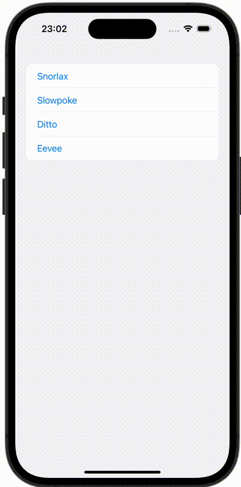

+++
title = "SwiftUIでListViewからそれぞれ別のViewに遷移する"
url = "2023-10-26"
date = "2023-10-26"
description = "SwiftUIでListViewからそれぞれ別のViewに遷移する"
tags = ["Swift", "SwiftUI"]
categories = ["SwiftUI"]
archives = "2023/10"
+++

<br>

SwiftUIでListViewからそれぞれ別のViewに遷移する方法です。



<!--more-->

**ContentView.swift**

```swift
import SwiftUI

struct ContentView: View {
    @State var pokemon: Pokemon?
    var body: some View {
        NavigationStack {
            List (Pokemon.allCases) { pokemon in
                Button {
                    self.pokemon = pokemon
                } label: {
                    Text(pokemon.description)
                }
            }
            .navigationDestination(item: $pokemon) { pokemon in
                switch pokemon {
                case .snorlax:
                    Image(.snorlax)
                        .resizable()
                        .scaledToFit()
                case .slowpoke:
                    VStack {
                        Image(.slowpoke)
                            .resizable()
                            .scaledToFit()
                        Text("Snorlax")
                    }
                case .ditto:
                    HStack {
                        Image(.ditto)
                            .resizable()
                            .scaledToFit()
                        Text("Ditto")
                    }
                case .eevee:
                    Text("Eevee")
                }
            }
        }
    }
}
```


**Pokemon.swift**

```swift
import Foundation

enum Pokemon: Identifiable, CaseIterable, CustomStringConvertible {
    var id: Int {
        self.hashValue
    }
    case snorlax
    case slowpoke
    case ditto
    case eevee
    
    var description : String {
      switch self {
      case .snorlax:
          "Snorlax"
      case .slowpoke:
          "Slowpoke"
      case .ditto:
          "Ditto"
      case .eevee:
          "Eevee"
      }
    }
}
```

