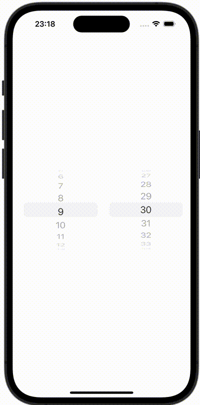

+++
title = "SwiftUIで複数行のPickerを作成する"
url = "2023-10-27"
date = "2023-10-27"
description = "SwiftUIで複数行のPickerを作成する"
tags = ["Swift", "SwiftUI"]
categories = ["SwiftUI"]
archives = "2023/10"
+++

<br>

SwiftUIで複数行のPickerを作成する方法です。




<!--more-->

**ContentView.swift**

```swift
import SwiftUI

struct ContentView: View {
    @State var selectedHour = 8
    @State var selectedMinute = 30

    var body: some View {
        GeometryReader { geometry in
            HStack {
                Picker(selection: $selectedHour, label: EmptyView()) {
                    ForEach(0 ..< 24) {
                        Text("\($0)")
                    }
                }
                .pickerStyle(WheelPickerStyle())
                .onReceive([selectedHour].publisher.first()) { (value) in
                    print("hour: \(value)")
                }.labelsHidden()
                    .frame(width: geometry.size.width / 2, height: geometry.size.height)
                    .clipped()

                Picker(selection: $selectedMinute, label: EmptyView()) {
                    ForEach(0 ..< 60) {
                        Text("\($0)")
                    }
                }
                .pickerStyle(WheelPickerStyle())
                .onReceive([selectedMinute].publisher.first()) { value in
                    print("minute: \(value)")
                }
                .labelsHidden()
                .frame(width: geometry.size.width / 2, height: geometry.size.height)
                .clipped()
            }
        }
        .padding()
    }
}

#Preview {
    ContentView()
}
```

