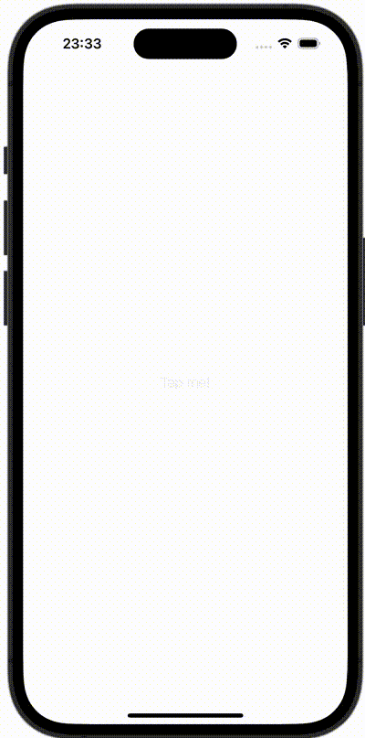

+++
title = "SwiftUIでSheetを表示する"
url = "2023-10-28"
date = "2023-10-28"
description = "SwiftUIでSheetを表示する"
tags = ["Swift", "SwiftUI"]
categories = ["SwiftUI"]
archives = "2023/10"
+++

<br>

SwiftUIでSheetを表示する方法です。



<!--more-->

**ContentView.swift**

```swift
import SwiftUI

struct ContentView: View {
    @State var showingSheet = false
    var body: some View {
        VStack {
            Button(action: {
                showingSheet = true
            }) {
                Text("Tap me!")
            }
        }
        .sheet(isPresented: $showingSheet) {
            Text("Sheet!!")
        }
    }
}

#Preview {
    ContentView()
}
```


**SecondView.swift**

```swift
import SwiftUI

struct SecondView: View {
    @Environment(\.dismiss) var dismiss

    var body: some View {
        VStack {
            Button(action: {
                dismiss()
            }) {
                Text("Dismiss")
            }
        }
        .frame(maxWidth: .infinity, maxHeight: .infinity)
        .background(Color.white)
    }
}

#Preview {
    SecondView()
}
```

