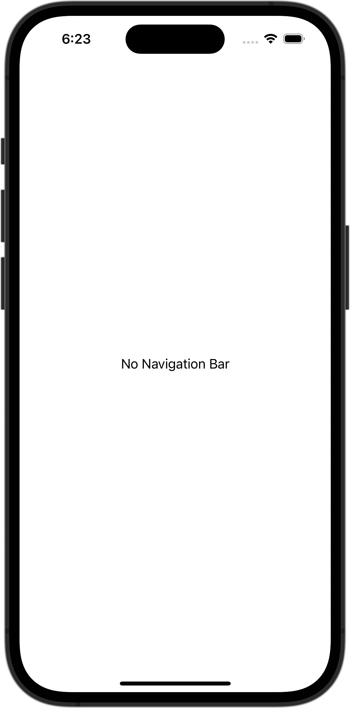

+++
title = "SwiftUIでNavigationBarを隠す"
url = "2023-10-30"
date = "2023-10-30"
description = "SwiftUIでNavigationBarを隠す"
tags = ["Swift", "SwiftUI"]
categories = ["SwiftUI"]
archives = "2023/10"
+++

<br>

SwiftUIでNavigationBarを隠す方法です。




<!--more-->

**ContentView.swift**

```swift
import SwiftUI

struct ContentView: View {
    var body: some View {
        NavigationStack {
            Text("No Navigation Bar")
                .navigationBarTitle("Not Showing Title")
                .navigationBarHidden(true)
        }
    }
}

#Preview {
    ContentView()
}
```

