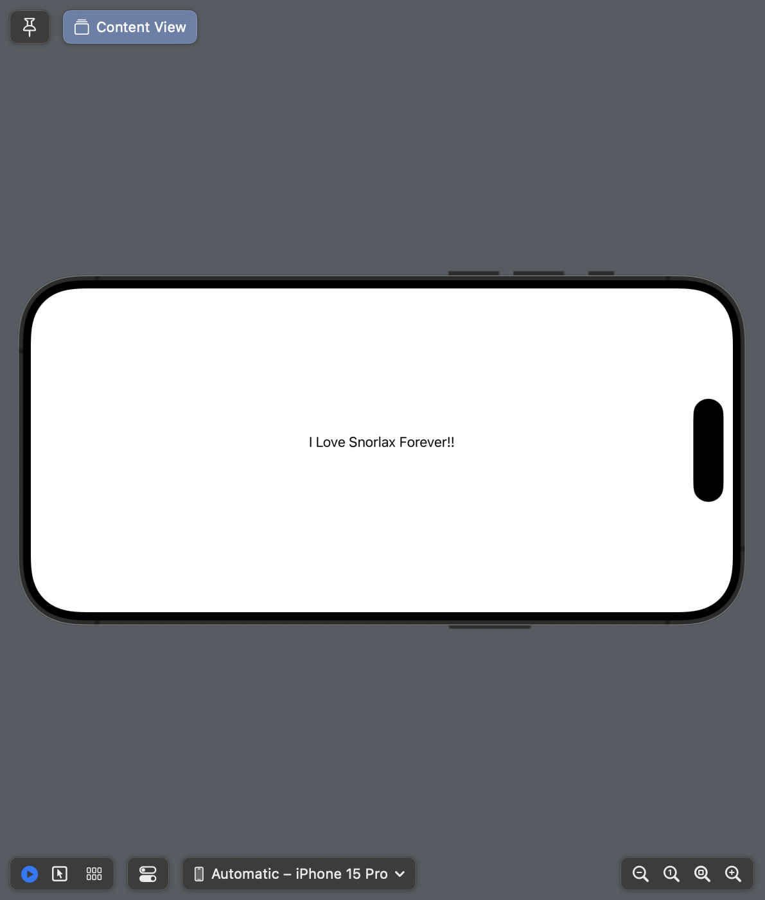

+++
title = "SwiftUIでPreviewを横向きにする"
url = "2023-10-31"
date = "2023-10-31"
description = "SwiftUIでPreviewを横向きにする"
tags = ["Swift", "SwiftUI"]
categories = ["SwiftUI"]
archives = "2023/10"
+++

<br>

SwiftUIでPreviewを横向きにする方法です。



<!--more-->

**ContentView.swift**

```swift
import SwiftUI

struct ContentView: View {
    var body: some View {
        Text("I Love Snorlax Forever!!")
    }
}

struct ContentView_Previews: PreviewProvider {
    static var previews: some View {
        ContentView()
            .previewInterfaceOrientation(.landscapeLeft)
    }
}
```

