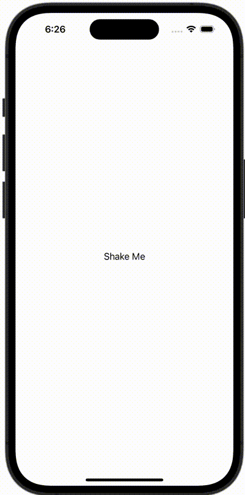

+++
title = "端末のシェイクを検知する"
url = "2023-11-01"
date = "2023-11-01"
description = "端末のシェイクを検知する"
tags = ["Swift", "SwiftUI"]
categories = ["SwiftUI"]
archives = "2023/11"
+++

<br>

端末のシェイクを検知する



<!--more-->

**ContentView.swift**

```swift
import SwiftUI

struct ContentView: View {
    @State var message = "Shake Me"

    var body: some View {
        Text(message)
            .onReceive(NotificationCenter.default.publisher(for: .deviceDidShakeNotification)) { _ in
                message = "Device Did Shake"
        }
    }
}

#Preview {
    ContentView()
}
```


**NSNotification+Extension.swift**

```swift
import Foundation

extension NSNotification.Name {
    public static let deviceDidShakeNotification = NSNotification.Name("DeviceDidShakeNotification")
}
```


**UIWindow+Extension.swift**

```swift
import Foundation

extension UIWindow {
    open override func motionEnded(_ motion: UIEvent.EventSubtype, with event: UIEvent?) {
        super.motionEnded(motion, with: event)
        NotificationCenter.default.post(name: .deviceDidShakeNotification, object: event)
    }
}
```

