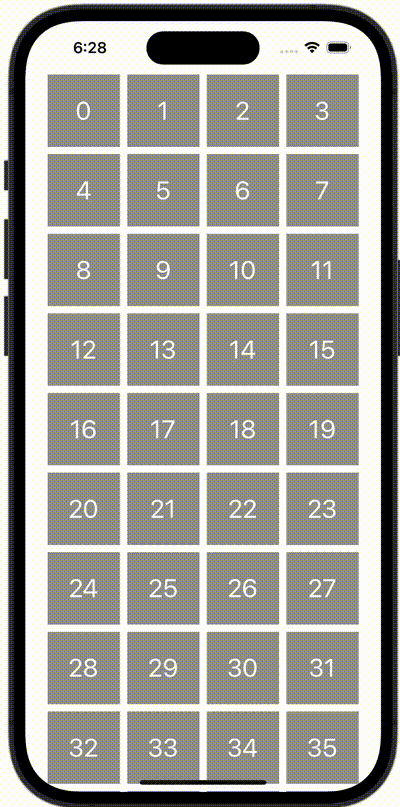

+++
title = "UICollectionViewのようにViewを並べる"
url = "2023-11-02"
date = "2023-11-02"
description = "UICollectionViewのようにViewを並べる"
tags = ["Swift", "SwiftUI"]
categories = ["SwiftUI"]
archives = "2023/11"
+++

<br>

UICollectionViewのようにViewを並べる方法です。



<!--more-->

**ContentView.swift**

```swift
import SwiftUI

struct ContentView: View {
    let columns = [GridItem(.fixed(80)), GridItem(.fixed(80)), GridItem(.fixed(80)), GridItem(.fixed(80))]

    var body: some View {
        ScrollView {
            LazyVGrid(columns: columns) {
                ForEach(0..<100, id: \.self) { number in
                    Text("\(number)")
                        .foregroundStyle(Color.white)
                        .font(.title)
                        .frame(width: 80, height: 80)
                        .background(Color.gray)
                }
            }
        }
    }
}

#Preview {
    ContentView()
}
```

