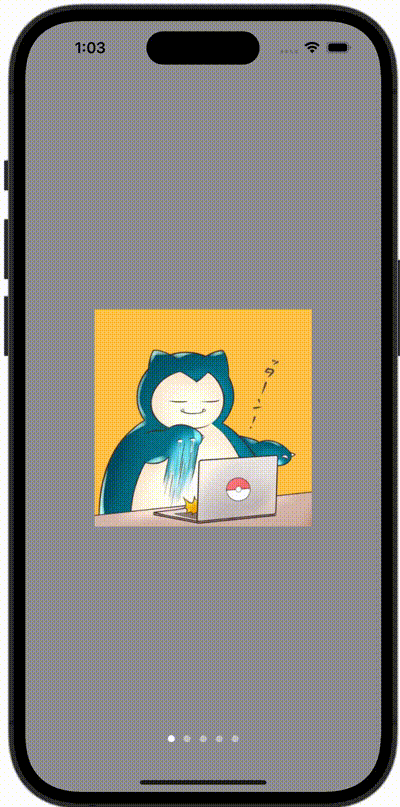

+++
title = "スワイプで遷移するチュートリアル画面を作る"
url = "2023-11-03"
date = "2023-11-03"
description = "スワイプで遷移するチュートリアル画面を作る"
tags = ["Swift", "SwiftUI"]
categories = ["SwiftUI"]
archives = "2023/10"
+++

<br>

スワイプで遷移するチュートリアル画面を作る方法です。



<!--more-->

**ContentView.swift**

```swift
import SwiftUI

struct ContentView: View {
    var body: some View {
        TabView {
            ContentViewCell(image: Image(.snorlax))
            ContentViewCell(image: Image(.magnemite))
            ContentViewCell(image: Image(.psyduck))
            ContentViewCell(image: Image(.quagsire))
            ContentViewCell(image: Image(.slowpoke))
        }
        .frame(maxWidth: .infinity, maxHeight: .infinity)
        .background(Color.gray)
        .tabViewStyle(.page)
        .menuIndicator(.visible)
    }
}
```


**ContentViewCell.swift**

```swift
import SwiftUI

struct ContentViewCell: View {
    let image: Image
    
    var body: some View {
        image
            .resizable()
            .scaledToFit()
            .frame(width: 240, height: 240)
            .background(Color.white)
    }
}
```

