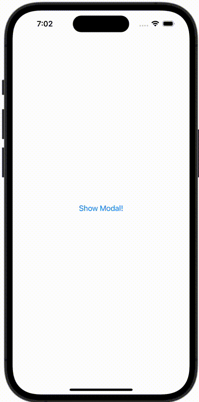

+++
title = "SwiftUIで閉じることができないモーダルを表示する"
url = "2023-11-04"
date = "2023-11-04"
description = "SwiftUIで閉じることができないモーダルを表示する"
tags = ["Swift", "SwiftUI"]
categories = ["SwiftUI"]
archives = "2023/11"
+++

<br>

SwiftUIで閉じることができないモーダルを表示する方法です。



<!--more-->

**ContentView.swift**

```swift
import SwiftUI

struct ContentView: View {
    @State var showingSheet = false
    var body: some View {

        Button(action: {
            showingSheet = true
        }, label: {
            Text("Show Modal!")
        })
        .sheet(isPresented: $showingSheet) {
            ModalView()
        }
    }
}

#Preview {
    ContentView()
}
```


**ModalView.swift**

```swift
import SwiftUI

struct ModalView: View {
    @Environment(\.dismiss) var dismiss

    var body: some View {
        Button(action: {
            dismiss()
        }, label: {
            Text("Close")
        })
        .interactiveDismissDisabled(true)
    }
}
```

