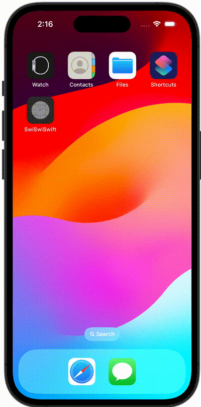

+++
title = "SwiftUIでアプリ起動時に画面を遷移させる"
url = "2023-11-05"
date = "2023-11-05"
description = "SwiftUIでアプリ起動時に画面を遷移させる"
tags = ["Swift", "SwiftUI"]
categories = ["SwiftUI"]
archives = "2023/11"
+++

<br>

SwiftUIでアプリ起動時に画面を遷移させる方法です。



<!--more-->

**ContentView.swift**

```swift
import SwiftUI

struct ContentView: View {
    @State var viewType: ViewType = .launch

    var body: some View {
        ZStack {
            switch viewType {
            case .launch:
                Text("Launch")
            case .home:
                Text("Home")
            }
        }
        .onAppear {
            Task {
                try? await sleep()
                withAnimation(.linear(duration: 0.5)) {
                    viewType = .home
                }
            }
        }
    }

    func sleep() async throws {
        // sleep 2sec
        _ = try await Task.sleep(nanoseconds: 2_000_000_000)
    }
}

#Preview {
    ContentView()
}
```

