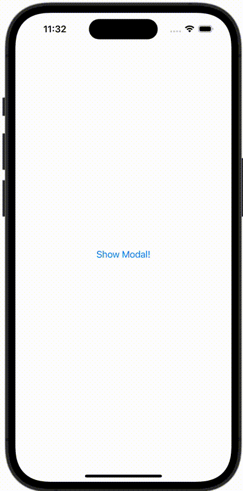

+++
title = "SwiftUIでハーフモーダルを表示する"
url = "2023-11-06"
date = "2023-11-06"
description = "SwiftUIでハーフモーダルを表示する"
tags = ["Swift", "SwiftUI"]
categories = ["SwiftUI"]
archives = "2023/11"
+++

<br>

SwiftUIでハーフモーダルを表示する方法です。



<!--more-->

**ContentView.swift**

```swift
import SwiftUI

struct ContentView: View {
    @State var showingSheet = false
    var body: some View {

        Button(action: {
            showingSheet = true
        }, label: {
            Text("Show Modal!")
        })
        .sheet(isPresented: $showingSheet) {
            Text("Half Modal")
                .presentationDetents([.medium])

        }
    }
}

#Preview {
    ContentView()
}
```

