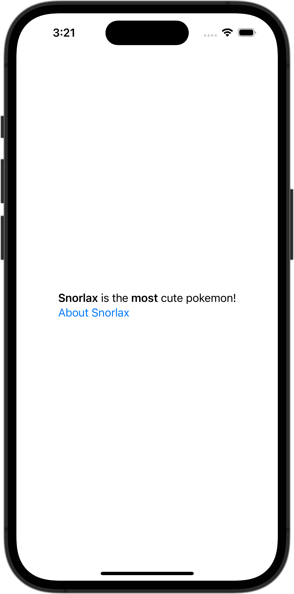

+++
title = "マークダウンを表示する"
url = "2023-11-07"
date = "2023-11-07"
description = "マークダウンを表示する"
tags = ["Swift", "SwiftUI"]
categories = ["SwiftUI"]
archives = "2023/10"
+++

<br>

マークダウンを表示する方法です。



<!--more-->

**ContentView.swift**

```swift
import SwiftUI

struct ContentView: View {
    var body: some View {
        Text("**Snorlax** is the **most** cute pokemon!\n[About Snorlax](https://en.wikipedia.org/wiki/Snorlax)")
    }
}

#Preview {
    ContentView()
}
```

