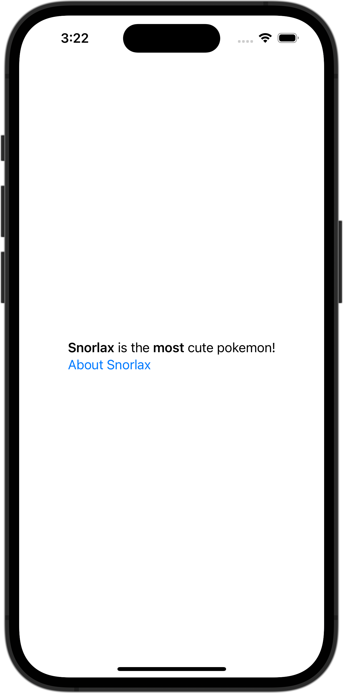

+++
title = "変数に格納したマークダウンを表示する"
url = "2023-11-08"
date = "2023-11-08"
description = "変数に格納したマークダウンを表示する"
tags = ["Swift", "SwiftUI"]
categories = ["SwiftUI"]
archives = "2023/11"
+++

<br>

変数に格納したマークダウンを表示する方法です。



<!--more-->

**ContentView.swift**

```swift
import SwiftUI

struct ContentView: View {
    let markdownText: String = "**Snorlax** is the **most** cute pokemon!\n[About Snorlax](https://en.wikipedia.org/wiki/Snorlax)"

    var body: some View {
        Text(LocalizedStringKey(markdownText))
    }
}

#Preview {
    ContentView()
}
```

