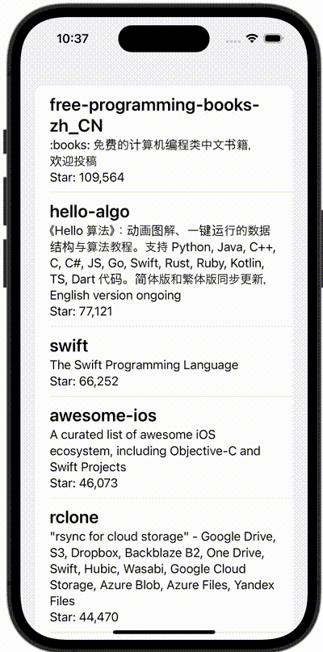

+++
title = "GithubのAPIを叩き、リポジトリの情報をリストに表示する（async, await）"
url = "2023-11-10"
date = "2023-11-10"
description = "GithubのAPIを叩き、リポジトリの情報をリストに表示する（async, await）"
tags = ["Swift", "SwiftUI"]
categories = ["SwiftUI"]
archives = "2023/11"
+++

<br>

GithubのAPIを叩き、リポジトリの情報をリストに表示する（async, await）方法です。



<!--more-->

**ContentView.swift**

```swift
import SwiftUI

struct ContentView: View {
    @State var repositories: [Repository] = []
    @State var showingErrorAlert = false

    let gitHubAPIRepository = GitHubAPIRepository()

    var body: some View {
            List(repositories) { repository in
                VStack(alignment: .leading) {
                    Text(repository.name)
                        .font(Font.system(size: 24).bold())
                    Text(repository.description ?? "")
                    Text("Star: \(repository.stargazersCount)")
                }
            }.onAppear {
                fetchRepositories()
            }
            .alert("Error", isPresented: $showingErrorAlert) {
                Button("Close", action: {})
            } message: {
                Text("Failed to Fetch repositories.")
            }

    }

    @MainActor
    func fetchRepositories() {
        Task {
            do {
                repositories = try await gitHubAPIRepository.searchRepos(page: 1, perPage: 20)
            } catch {
                showingErrorAlert = true
            }
        }
    }
}

#Preview {
    ContentView()
}
```


**Repository.swift**

```swift
import Foundation

struct GitHubAPIRepository {
    func searchRepos(page: Int, perPage: Int) async throws -> [Repository] {
        let url = URL(string: "https://api.github.com/search/repositories?q=swift&sort=stars&page=\(page)&per_page=\(perPage)")!
        let (data, _) = try await URLSession.shared.data(from: url)
        let response = try JSONDecoder().decode(GithubSearchResult.self, from: data)
        return response.items
    }
}

struct GithubSearchResult: Codable {
    let items: [Repository]
}

struct Repository: Codable, Identifiable, Equatable {
    let id: Int
    let name: String
    let description: String?
    let stargazersCount: Int

    enum CodingKeys: String, CodingKey {
        case id
        case name
        case description
        case stargazersCount = "stargazers_count"
    }
}
```

