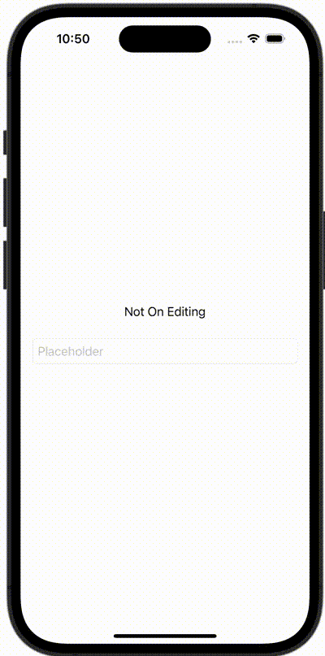

+++
title = "SwiftUIのTextFieldで編集中と編集完了を検知する"
url = "2023-11-13"
date = "2023-11-13"
description = "SwiftUIのTextFieldで編集中と編集完了を検知する"
tags = ["Swift", "SwiftUI"]
categories = ["SwiftUI"]
archives = "2023/11"
+++

<br>

SwiftUIのTextFieldで編集中と編集完了を検知する方法です。



<!--more-->

**ContentView.swift**

```swift
import SwiftUI

struct ContentView: View {
    @State var userName: String = ""
    @State var onEditing: Bool = false

    var body: some View {
        VStack {
            Text(onEditing ? "On Editing" : "Not On Editing")

            TextField("Placeholder", text: $userName, onEditingChanged: { onEditing in
                print("onEditingChanged: \(onEditing)")
                self.onEditing = onEditing
            }, onCommit: {
                print("onCommit")
            })
            .textFieldStyle(RoundedBorderTextFieldStyle())
            .padding()
        }
    }
}

#Preview {
    ContentView()
}
```

