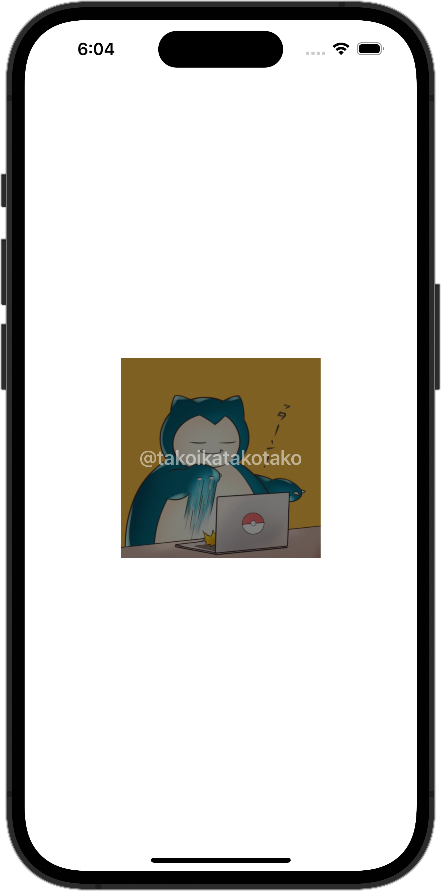

+++
title = "SwiftUIでViewの上にViewを重ねる"
url = "2023-11-15"
date = "2023-11-15"
description = "SwiftUIでViewの上にViewを重ねる"
tags = ["Swift", "SwiftUI"]
categories = ["SwiftUI"]
archives = "2023/11"
+++

<br>

SwiftUIでViewの上にViewを重ねる方法です。



<!--more-->

**ContentView.swift**

```swift
import SwiftUI

struct ContentView: View {
    var body: some View {
        Image(.icon)
            .resizable()
            .frame(width: 200, height: 200)
            .overlay(
                Text("@takoikatakotako")
                    .foregroundColor(Color.white)
                    .font(Font.system(size: 20).bold())
                    .frame(minWidth: 0, maxWidth: .infinity, minHeight: 0, maxHeight: .infinity)
                    .background(Color.black)
                    .opacity(0.5)
            )
    }
}

#Preview {
    ContentView()
}
```

