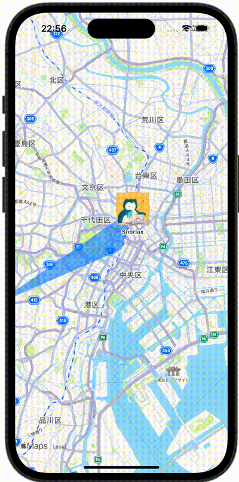

+++
title = "SwiftUIでMapを使う。Mapに画像や図形を表示する"
url = "2023-11-16"
date = "2023-11-16"
description = "SwiftUIでMapを使う。Mapに画像や図形を表示する"
tags = ["Swift", "SwiftUI"]
categories = ["SwiftUI"]
archives = "2023/11"
+++

<br>

SwiftUIでMapを使う。Mapに画像や図形を表示する法です。



<!--more-->

**ContentView.swift**

```swift
import SwiftUI
import MapKit

struct ContentView: View {
    // Tokyo Station(35.6812° N, 139.7671° E)
    let tokyoStation = MKCoordinateRegion(center: CLLocationCoordinate2D(latitude: 35.6812, longitude: 139.7671), latitudinalMeters: 10000, longitudinalMeters: 10000)

    var body: some View {
        Map(initialPosition: .region(tokyoStation)) {
            // Akihabara Station(35.6984° N, 139.7731° E)
            MapCircle(center: CLLocationCoordinate2D(latitude: 35.6984, longitude: 139.7731), radius: CLLocationDistance(800))
                .foregroundStyle(.orange.opacity(0.60))
                .mapOverlayLevel(level: .aboveLabels)

            // Snorlax at Akihabara Station(35.6984° N, 139.7731° E)
            Annotation("Snorlax", coordinate: CLLocationCoordinate2D(latitude: 35.6984, longitude: 139.7731)) {
                Image(.snorlax)
                    .resizable()
                    .frame(width: 60, height: 60)
                    .scaledToFit()
            }

            // Polygon
            MapPolygon(coordinates: [
                // Shibuya Station(35.6580° N, 139.7016° E)
                CLLocationCoordinate2D(latitude: 35.6580, longitude: 139.7016),

                // Akihabara Station(35.6984° N, 139.7731° E)
                CLLocationCoordinate2D(latitude: 35.6984, longitude: 139.7731),
                
                // Tokyo Station(35.6812° N, 139.139.7671° E)
                CLLocationCoordinate2D(latitude: 35.6812, longitude: 139.7671)
            ])
            .foregroundStyle(.blue.opacity(0.60))
            .mapOverlayLevel(level: .aboveLabels)
        }
    }
}
```

