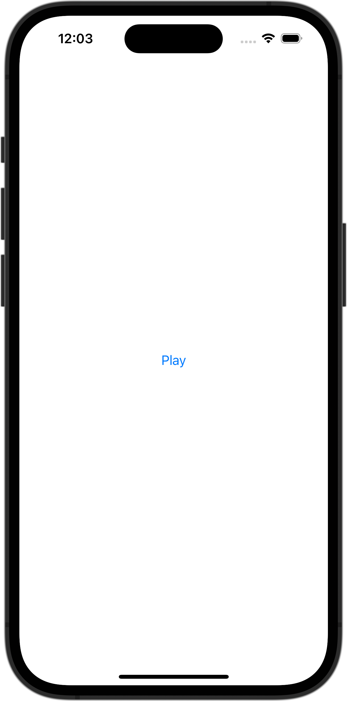

+++
title = "SwiftUIでAVAudioPlayerで音楽を再生し、再生終了を検知する"
url = "2023-11-18"
date = "2023-11-18"
description = "SwiftUIでAVAudioPlayerで音楽を再生し、再生終了を検知する"
tags = ["Swift", "SwiftUI"]
categories = ["SwiftUI"]
archives = "2023/11"
+++

<br>

SwiftUIでAVAudioPlayerで音楽を再生し、再生終了を検知する方法です。



<!--more-->

**ContentView.swift**

```swift
import SwiftUI

struct ContentView: View {
    @StateObject var viewModel = ContentViewState()
    var body: some View {
        VStack {
            Button("Play") {
                viewModel.playAudio()
            }
        }
    }
}

#Preview {
    ContentView()
}
```


**ContentViewState.swift**

```swift
import SwiftUI
import AVFoundation

class ContentViewState: NSObject, ObservableObject {
    var audioPlayer: AVAudioPlayer?

    func playAudio() {
        guard let url = Bundle.main.url(forResource: "melody", withExtension: "mp3") else { return }
        audioPlayer = try? AVAudioPlayer(contentsOf: url)
        audioPlayer?.delegate = self
        audioPlayer?.play()
    }
}

extension ContentViewState: AVAudioPlayerDelegate {
    func audioPlayerDidFinishPlaying(_ player: AVAudioPlayer, successfully flag: Bool) {
        print("Did finish Playing")
    }
}
```

