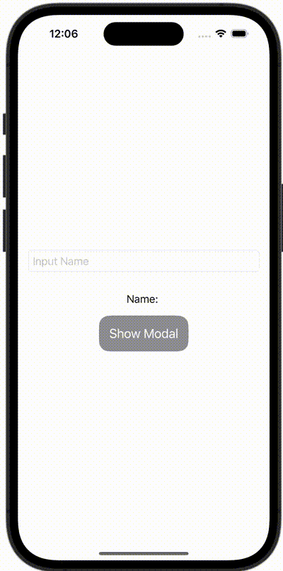

+++
title = "SwiftUIでモーダルを表示する時に値を渡す"
url = "2023-11-19"
date = "2023-11-19"
description = "SwiftUIでモーダルを表示する時に値を渡す"
tags = ["Swift", "SwiftUI"]
categories = ["SwiftUI"]
archives = "2023/11"
+++

<br>

SwiftUIでモーダルを表示する時に値を渡す方法です。



<!--more-->

**ContentView.swift**

```swift
import SwiftUI

struct ContentView: View {
    @State var name = ""
    @State var showingSheet = false

    var body: some View {
        VStack(spacing: 16) {
            TextField("Input Name", text: $name)
                .textFieldStyle(RoundedBorderTextFieldStyle())
                .padding()
            Text("Name: \(name)")

            Button {
                showingSheet = true
            } label: {
                Text("Show Modal")
                    .font(Font.system(size: 20))
                    .foregroundColor(Color.white)
                    .padding(16)
                    .background(Color.gray)
                    .cornerRadius(16)
            }
            .sheet(isPresented: $showingSheet) {
                PokemonView(pokemonName: name)
            }
        }
    }
}

#Preview {
    ContentView()
}
```


**PokemonView.swift**

```swift
import SwiftUI

struct PokemonView: View {
    let pokemonName: String
    var body: some View {
        Text("Name: \(pokemonName)")
    }
}
```

