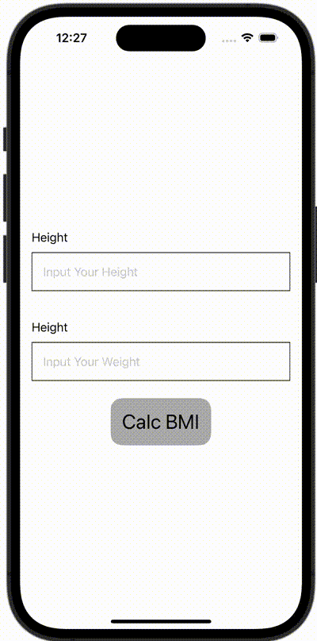

+++
title = "SwiftUIでBMIを計算し、結果を別のViewで表示する"
url = "2023-11-20"
date = "2023-11-20"
description = "SwiftUIでBMIを計算し、結果を別のViewで表示する"
tags = ["Swift", "SwiftUI"]
categories = ["SwiftUI"]
archives = "2023/11"
+++

<br>

SwiftUIでBMIを計算し、結果を別のViewで表示する方法です。



<!--more-->

**ContentView.swift**

```swift
import SwiftUI

struct ContentView: View {
    @State var height: String = ""
    @State var weight: String = ""
    @State var bmi: Double = 0
    @State var showingSheet = false

    var body: some View {
        VStack {
            VStack(alignment: .leading) {
                Text("Height")
                TextField("Input Your Height", text: $height)
                    .keyboardType(.numberPad)
                    .padding()
                    .border(Color.black, width: 1)
            }
            .padding()

            VStack(alignment: .leading) {
                Text("Height")
                TextField("Input Your Weight", text: $weight)
                    .keyboardType(.numberPad)
                    .padding()
                    .border(Color.black, width: 1)
            }
            .padding()

            Button(action: {
                guard let height = Double(self.height),
                      let weight = Double(self.weight) else {
                    print("Fail to Calc BMI")
                    return
                }

                // Calc BMI
                bmi = weight / (height / 100) / (height / 100)

                // Show Sheet
                showingSheet = true
            }, label: {
                Text("Calc BMI")
                    .font(.title)
                    .foregroundColor(Color.black)
                    .padding()
                    .background(Color(UIColor.lightGray))
                    .cornerRadius(16)
            })
        }
        .sheet(isPresented: $showingSheet) {
            ResultView(bmi: $bmi)
        }
    }
}

#Preview {
    ContentView()
}
```


**ResultView.swift**

```swift
import SwiftUI

struct ResultView: View {
    @Binding var bmi: Double
    var body: some View {
        VStack {
            Text("BMI: \(bmi)")

            if bmi < 18.5 {
                Text("You are thin")
                Image(.bellsprout)
                    .resizable()
                    .frame(width: 200, height: 200)
            } else if bmi > 25 {
                Text("You are fat")
                Image(.snorlax)
                    .resizable()
                    .frame(width: 200, height: 200)
            } else {
                Text("You are healthy")
                Image(.pikachu)
                    .resizable()
                    .frame(width: 200, height: 200)
            }
        }
    }
}
```

