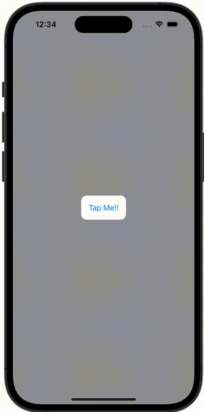

+++
title = "SwiftUIでボタンを押すとポップアップを表示する"
url = "2023-11-21"
date = "2023-11-21"
description = "SwiftUIでボタンを押すとポップアップを表示する"
tags = ["Swift", "SwiftUI"]
categories = ["SwiftUI"]
archives = "2023/11"
+++

<br>

SwiftUIでボタンを押すとポップアップを表示する法です。



<!--more-->

**ContentView.swift**

```swift
import SwiftUI

struct ContentView: View {
    @State var showingPopUp = false
    var body: some View {
        ZStack {
            Button(action: {
                withAnimation {
                    showingPopUp = true
                }
            }, label: {
                Text("Tap Me!!")
                    .padding()
                    .background(Color.white)
                    .cornerRadius(12)
            })

            if showingPopUp {
                PopupView(isPresent: $showingPopUp)
            }
        }
        .frame(minWidth: 0, maxWidth: .infinity, minHeight: 0, maxHeight: .infinity)
        .background(Color.gray)
        .ignoresSafeArea()
    }
}

#Preview {
    ContentView()
}
```


**PopupView.swift**

```swift
import SwiftUI

struct PopupView: View {
    @Binding var isPresent: Bool

    var body: some View {
        VStack(spacing: 12) {
            Text("Snorlax")
                .font(Font.system(size: 18).bold())

            Image("icon")
                .resizable()
                .frame(width: 80, height: 80)

            Text("Snorlax (Japanese: カビゴン Kabigon) is a Normal-type Pokemon. Snorlax is most popular Pokemon.")
                .font(Font.system(size: 18))

            Button(action: {
                withAnimation {
                    isPresent = false
                }
            }, label: {
                Text("Close")
            })
        }
        .frame(width: 280, alignment: .center)
        .padding()
        .background(Color.white)
        .cornerRadius(12)
    }
}
```

