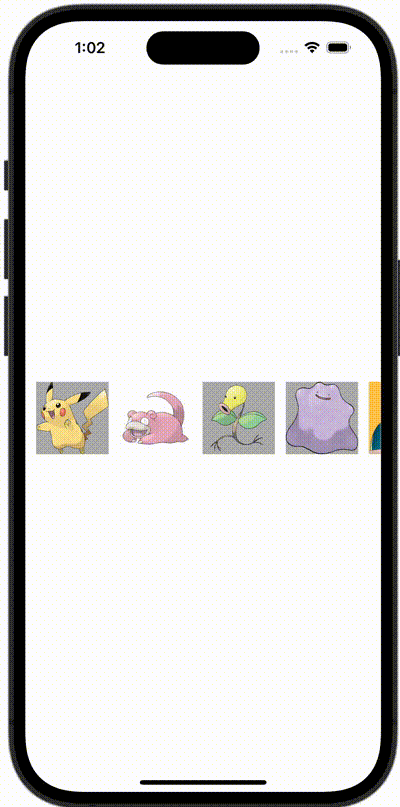

+++
title = "SwiftUIでViewを横スクロールで表示する"
url = "2023-11-22"
date = "2023-11-22"
description = "SwiftUIでViewを横スクロールで表示する"
tags = ["Swift", "SwiftUI"]
categories = ["SwiftUI"]
archives = "2023/11"
+++

<br>

SwiftUIでViewを横スクロールで表示する方法です。



<!--more-->

**ContentView.swift**

```swift
import SwiftUI

struct ContentView: View {
    var body: some View {
        let pokemons = ["pikachu", "slowpoke", "bellsprout", "ditto", "snorlax", "eevee", "magikarp"]

        ScrollView(.horizontal, showsIndicators: false) {
            LazyHStack(spacing: 12) {
                ForEach(pokemons, id: \.self) { pokemon in
                    Image(pokemon)
                        .resizable()
                        .frame(width: 80, height: 80)
                        .background(Color(UIColor.lightGray))
                }
            }
            .padding(.horizontal, 12)
        }
        .frame(height: 80)
    }
}

#Preview {
    ContentView()
}
```

