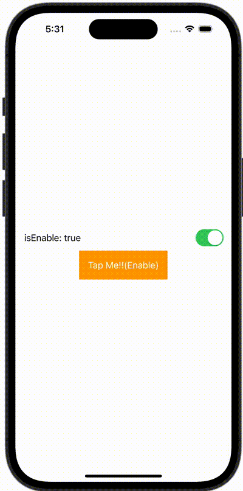

+++
title = "SwiftUIでButtonを有効にしたり無効にしたりする"
url = "2023-11-23"
date = "2023-11-23"
description = "SwiftUIでButtonを有効にしたり無効にしたりする"
tags = ["Swift", "SwiftUI"]
categories = ["SwiftUI"]
archives = "2023/11"
+++

<br>

SwiftUIでButtonを有効にしたり無効にしたりする方法です。



<!--more-->

**ContentView.swift**

```swift
import SwiftUI

struct ContentView: View {
    @State var enable: Bool = true

    var body: some View {
        VStack {
            Toggle(isOn: $enable) {
                Text("isEnable: \(enable.description)")
            }

            Button {
                print("Tapped!!")
            } label: {
                Text("Tap Me!!(\(enable ? "Enable": "Disable"))")
                    .foregroundColor(Color.white)
                    .padding()
                    .background(enable ? Color.orange: Color(UIColor.lightGray))
            }
            .disabled(!enable)
        }.padding()
    }
}

#Preview {
    ContentView()
}
```

