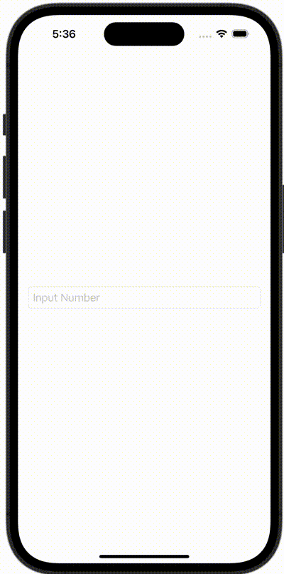

+++
title = "SwiftUIのTextFieldで表示するキーボードを指定する"
url = "2023-11-24"
date = "2023-11-24"
description = "SwiftUIのTextFieldで表示するキーボードを指定する"
tags = ["Swift", "SwiftUI"]
categories = ["SwiftUI"]
archives = "2023/10"
+++

<br>

SwiftUIのTextFieldで表示するキーボードを指定する方法です。



<!--more-->

**ContentView.swift**

```swift
import SwiftUI

struct ContentView: View {
    @State var numberString = ""

    var body: some View {
        TextField("Input Number", text: $numberString)
            .keyboardType(.decimalPad)
            .textFieldStyle(RoundedBorderTextFieldStyle())
            .padding()
    }
}

#Preview {
    ContentView()
}
```

