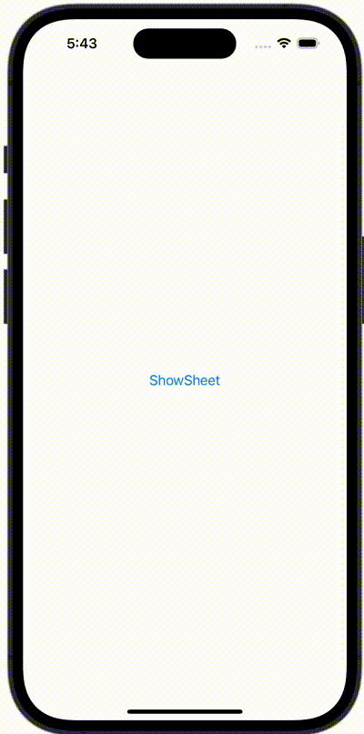

+++
title = "SwiftUIでシートを表示し、プッシュ遷移後にシートを閉じる"
url = "2023-11-25"
date = "2023-11-25"
description = "SwiftUIでシートを表示し、プッシュ遷移後にシートを閉じる"
tags = ["Swift", "SwiftUI"]
categories = ["SwiftUI"]
archives = "2023/11"
+++

<br>

SwiftUIでシートを表示し、プッシュ遷移後にシートを閉じる方法です。



<!--more-->

**ContentView.swift**

```swift
import SwiftUI

struct ContentView: View {
    @State var showingSheet: Bool = false

    var body: some View {
        Button(action: {
            showingSheet = true
        }, label: {
            Text("ShowSheet")
        })
        .sheet(isPresented: $showingSheet) {
            FirstSheet(showingSheet: $showingSheet)
        }
    }
}

#Preview {
    ContentView()
}
```

