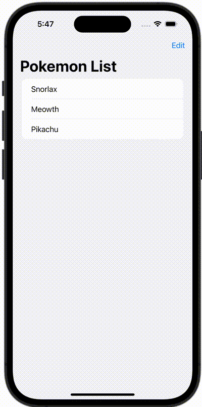

+++
title = "SwiftUIでListをEditModeにして並び替える"
url = "2023-11-26"
date = "2023-11-26"
description = "SwiftUIでListをEditModeにして並び替える"
tags = ["Swift", "SwiftUI"]
categories = ["SwiftUI"]
archives = "2023/11"
+++

<br>

SwiftUIでListをEditModeにして並び替える方法です。



<!--more-->

**ContentView.swift**

```swift
import SwiftUI

struct ContentView: View {
    @State var pokemons: [Pokemon] = [
        Pokemon(id: 143, name: "Snorlax"),
        Pokemon(id: 52, name: "Meowth"),
        Pokemon(id: 25, name: "Pikachu")
    ]

    var body: some View {
        NavigationStack {
            List {
                ForEach(pokemons) { pokemon in
                    Text(pokemon.name)
                }.onMove { (indexSet, index) in
                    pokemons.move(fromOffsets: indexSet, toOffset: index)
                }
            }
            .navigationBarTitle(Text("Pokemon List"))
            .navigationBarItems(trailing: EditButton())
        }
    }
}

#Preview {
    ContentView()
}
```

