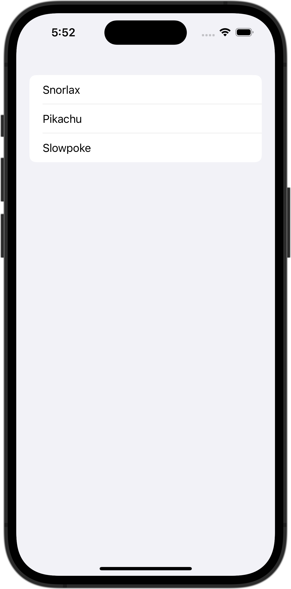

+++
title = "SwiftUIのListでSpacerの部分にもタップ判定をつける"
url = "2023-11-27"
date = "2023-11-27"
description = "SwiftUIのListでSpacerの部分にもタップ判定をつける"
tags = ["Swift", "SwiftUI"]
categories = ["SwiftUI"]
archives = "2023/11"
+++

<br>

SwiftUIのListでSpacerの部分にもタップ判定をつける方法です。



<!--more-->

**ContentView.swift**

```swift
import SwiftUI

struct ContentView: View {
    let pokemons: [String] = ["Snorlax", "Pikachu", "Slowpoke"]
    var body: some View {
        List(pokemons, id: \.self) {pokemon in
            HStack {
                Text(pokemon)
                Spacer()
            }
            .contentShape(Rectangle())
            .onTapGesture {
                print(pokemon)
            }
        }
    }
}

#Preview {
    ContentView()
}
```

