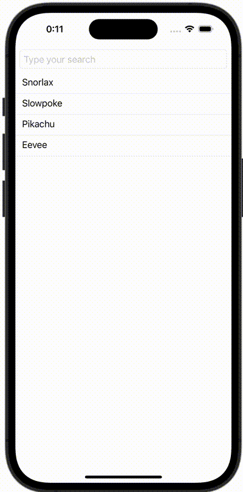

+++
title = "SwiftUIでSearchBar(TextField)にクリアボタンをつける"
url = "2023-11-30"
date = "2023-11-30"
description = "SwiftUIでSearchBar(TextField)にクリアボタンをつける"
tags = ["Swift", "SwiftUI"]
categories = ["SwiftUI"]
archives = "2023/11"
+++

<br>

SwiftUIでSearchBar(TextField)にクリアボタンをつける方法です。



<!--more-->

**ContentView.swift**

```swift
import SwiftUI

struct ContentView: View {
    @State var text: String = ""
    
    let pokemons: [String] = ["Snorlax", "Slowpoke", "Pikachu", "Eevee"]
    
    var filterdPokemons: [String] {
        if text.isEmpty {
            return pokemons
        } else {
            return pokemons.filter {$0.uppercased().contains(text.uppercased())}
        }
    }
    
    var body: some View {
        ScrollView {
            LazyVStack{
                ZStack(alignment: .trailing) {
                    TextField("Type your search",text: $text)
                        .textFieldStyle(RoundedBorderTextFieldStyle())
                    
                    if !text.isEmpty{
                        Button(action:
                                {
                            self.text = ""
                        })
                        {
                            Image(systemName: "delete.left")
                                .foregroundColor(Color(UIColor.opaqueSeparator))
                        }
                        .padding(.trailing, 8)
                    }
                }
                .padding(8)
                
                ForEach(filterdPokemons, id: \.self) { pokemon in
                    VStack(alignment: .leading) {
                        Text(pokemon)
                            .padding(.leading, 12)
                        Divider()
                    }
                }
            }
        }
    }
}
```

