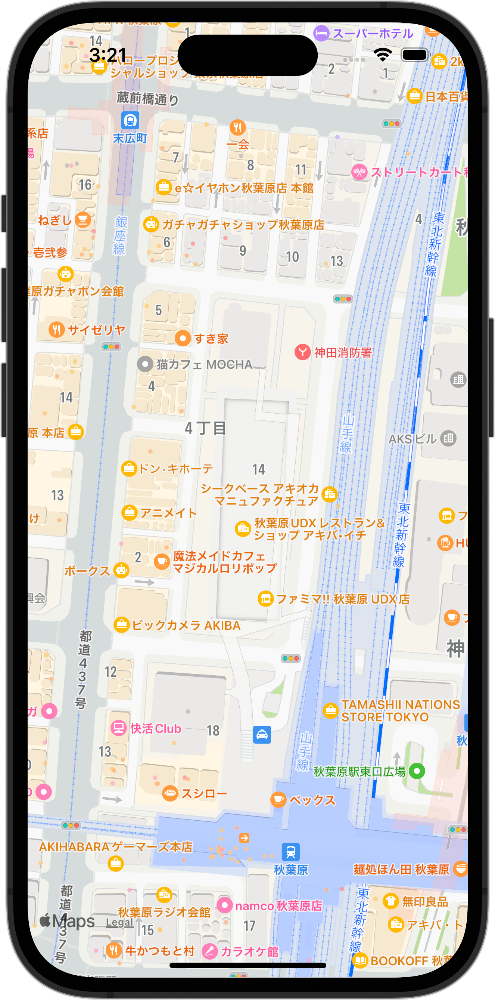

+++
title = "SwiftUIでMapを表示する"
url = "2023-12-01"
date = "2023-12-01"
description = "SwiftUIでMapを表示する"
tags = ["Swift", "SwiftUI"]
categories = ["SwiftUI"]
archives = "2023/12"
+++

<br>

SwiftUIを使ってMapを表示してください。秋葉原UDX（35.7005° N, 139.7726° E）を中心として、300mの範囲を表示しています。



<!--more-->

**ContentView.swift**

```swift
import SwiftUI
import MapKit

struct ContentView: View {
    var body: some View {
        Map(
            initialPosition:
                MapCameraPosition.region(
                    MKCoordinateRegion(
                        center: CLLocationCoordinate2D(latitude: 35.7005, longitude: 139.7726),
                        latitudinalMeters: 300,
                        longitudinalMeters: 300
                    )
                )
        )
    }
}

#Preview {
    ContentView()
}
```

