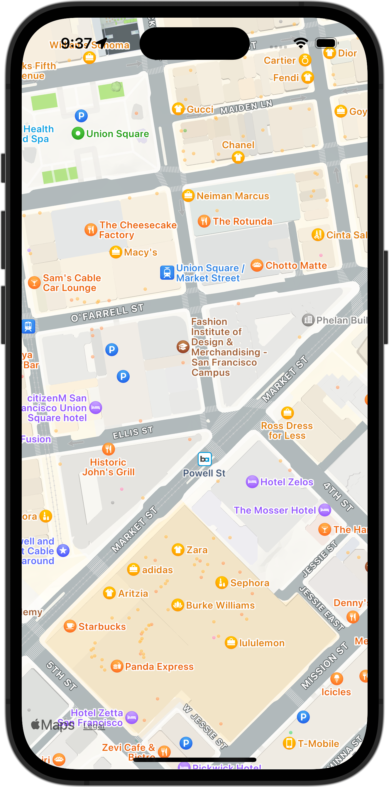

+++
title = "SwiftUIでMapを表示し、自分の位置を中心にする"
url = "2023-12-02"
date = "2023-12-02"
description = "SwiftUIでMapを表示し、自分の位置を中心にする"
tags = ["Swift", "SwiftUI"]
categories = ["SwiftUI"]
archives = "2023/12"
+++

<br>

SwiftUIでMapを表示し、自分の位置を中心にする方法です。



<!--more-->

**ContentView.swift**

```swift
import SwiftUI
import MapKit

struct ContentView: View {
    @StateObject var viewState: ContentViewState = ContentViewState()

    var body: some View {
        ZStack {
            if let location = viewState.location {
                Map(
                    initialPosition:
                        MapCameraPosition.region(
                            MKCoordinateRegion(
                                center: location,
                                latitudinalMeters: 300,
                                longitudinalMeters: 300
                            )
                        )
                )
            } else {
                Text("Loading...")
            }
        }
        .onAppear {
            viewState.onAppear()
        }
    }
}

#Preview {
    ContentView(viewState: ContentViewState())
}
```


**ContentViewState.swift**

```swift
import Foundation
import CoreLocation

class ContentViewState: NSObject, ObservableObject {
    @Published var location: CLLocationCoordinate2D?
    private let locationManager = CLLocationManager()

    func onAppear() {
        locationManager.delegate = self
        locationManager.requestWhenInUseAuthorization()
        let status = locationManager.authorizationStatus
        switch status {
        case .authorizedWhenInUse:
            locationManager.startUpdatingLocation()
        default:
            break
        }
    }
}

extension ContentViewState: CLLocationManagerDelegate {
    func locationManager(_ manager: CLLocationManager, didChangeAuthorization status: CLAuthorizationStatus) {
        switch status {
        case .authorizedWhenInUse:
            locationManager.startUpdatingLocation()
        default:
            break
        }
    }

    func locationManager(_ manager: CLLocationManager, didUpdateLocations locations: [CLLocation]) {
        self.location = manager.location?.coordinate
    }
}
```

