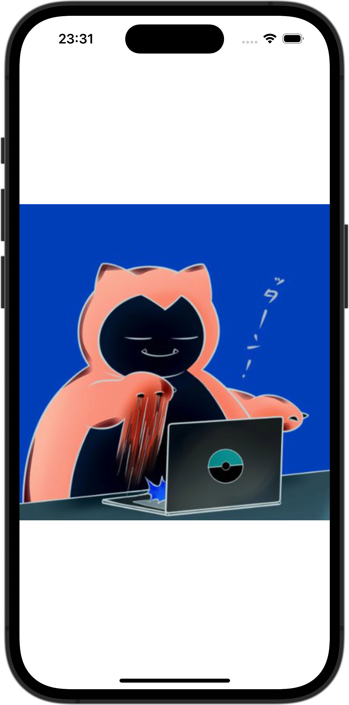

+++
title = "SwiftUIでImageの色を反転させる"
url = "2023-12-05"
date = "2023-12-05"
description = "SwiftUIでImageの色を反転させる"
tags = ["Swift", "SwiftUI"]
categories = ["SwiftUI"]
archives = "2023/12"
+++

<br>

SwiftUIでImageの色を反転させる方法です。



<!--more-->

**ContentView.swift**

```swift
import SwiftUI

struct ContentView: View {
    var body: some View {
        VStack {
            Image(.snorlax)
                .colorInvert()
        }
    }
}
```

