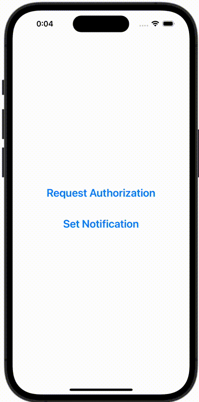

+++
title = "SwiftUIでローカル通知を送信する"
url = "2023-12-08"
date = "2023-12-08"
description = "SwiftUIでローカル通知を送信する"
tags = ["Swift", "SwiftUI"]
categories = ["SwiftUI"]
archives = "2023/12"
+++

<br>

SwiftUIでローカル通知を送信する方法です。



<!--more-->

**ContentView.swift**

```swift
import SwiftUI

struct ContentView: View {
    var body: some View {
        VStack {
            Button {
                requestAuthorization()
            } label: {
                Text("Request Authorization")
                    .font(Font.system(size: 24).bold())
            }
            .padding()
            
            Button {
                setNotification()
            } label: {
                Text("Set Notification")
                    .font(Font.system(size: 24).bold())
            }
            .padding()
        }
    }
    
    func requestAuthorization() {
        UNUserNotificationCenter.current().requestAuthorization(options: [.alert, .sound, .badge]) { granted, error in
            if let error = error {
                print(error.localizedDescription)
            }
            
            if granted {
                print("Allowed!!")
            }else{
                print("Denied...")
            }
        }
    }
    
    func setNotification() {
        let content = UNMutableNotificationContent()
        content.title = "Notification Title"
        content.body = "Notification Body"
        let trigger = UNTimeIntervalNotificationTrigger(timeInterval: 5, repeats: false)
        let request = UNNotificationRequest(identifier: "Notification ID", content: content, trigger: trigger)
        UNUserNotificationCenter.current().add(request)
    }
}
```

