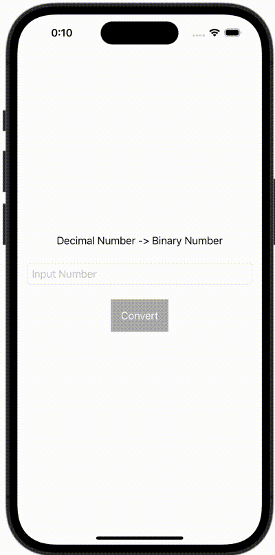

+++
title = "Swiftで10進数を2進数に変換する"
url = "2023-12-09"
date = "2023-12-09"
description = "Swiftで10進数を2進数に変換する"
tags = ["Swift", "SwiftUI"]
categories = ["SwiftUI"]
archives = "2023/12"
+++

<br>

Swiftで10進数を2進数に変換する方法です。



<!--more-->

**ContentView.swift**

```swift
import SwiftUI

struct ContentView: View {
    @State var numberString = ""
    @State var result = ""
  
    var body: some View {
        VStack {
            Text("Decimal Number -> Binary Number")
            TextField("Input Number", text: $numberString)
                .keyboardType(.decimalPad)
                .textFieldStyle(RoundedBorderTextFieldStyle())
                .padding()
            
            Button(action: {
                guard let number = Double(numberString) else {
                    return
                }
                result = convert(number: number)
            }, label: {
                Text("Convert")
                    .foregroundColor(Color.white)
                    .padding()
                    .background(Color(UIColor.lightGray))
            })
            
            Text(result)
        }
    }
    
    func convert(number: Double) -> String {
        let integer: Int = Int(number)
        let fraction: Double = number.truncatingRemainder(dividingBy: 1)
        return intToBinaryNumberString(number: integer) + "." + doubleToBinaryNumberString(number: fraction)
    }

    func intToBinaryNumberString(number: Int) -> String {
         let remainder: Int = number % 2
         return number / 2 == 0 ? String(remainder) : String(remainder) + intToBinaryNumberString(number: number / 2)
        // or return String(num, radix: 2)
    }
    
    func doubleToBinaryNumberString(number: Double) -> String {
        var number = number
        var result: String = ""
        for _ in 0...6 {
            number = number * 2
            result += String(Int(number))
            number = number.truncatingRemainder(dividingBy: 1)
            if number == 0 {
                return result
            }
        }
        return result + "..."
    }
}
```

