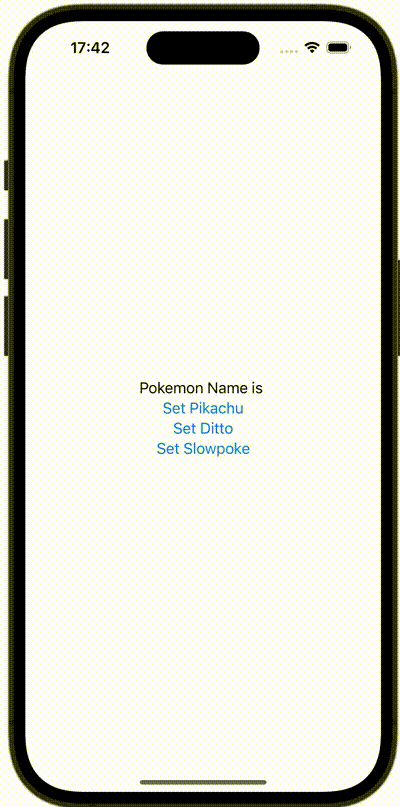

+++
title = "SwiftUIでAppDelegateを使用する"
url = "2023-12-10"
date = "2023-12-10"
description = "SwiftUIでAppDelegateを使用する"
tags = ["Swift", "SwiftUI"]
categories = ["SwiftUI"]
archives = "2023/12"
+++

<br>

SwiftUIでAppDelegateを使用する方法です。アプリ終了時にUserDefaultsに値を保存しています。



<!--more-->

**ContentView.swift**

```swift
import SwiftUI

struct ContentView: View {
    @State var pokemon = ""
    var body: some View {
        VStack {
            Text("Pokemon Name is \(pokemon)")
            
            Button {
                UserDefaults().setValue("Pikachu", forKey: "POKEMON")
                getPokemon()
            } label: {
                Text("Set Pikachu")
            }
            
            Button {
                UserDefaults().setValue("Ditto", forKey: "POKEMON")
                getPokemon()
            } label: {
                Text("Set Ditto")
            }
            
            Button {
                UserDefaults().setValue("Slowpoke", forKey: "POKEMON")
                getPokemon()
            } label: {
                Text("Set Slowpoke")
            }
        }
        .onAppear {
            getPokemon()
        }
    }
    
    func getPokemon() {
        if let pokemon = UserDefaults().value(forKey: "POKEMON") as? String {
            self.pokemon = pokemon
        }
    }
}
```

