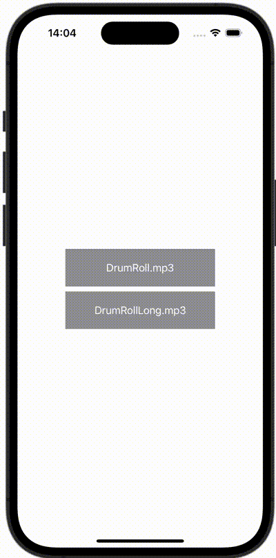

+++
title = "SwiftUIで音楽を再生する"
url = "2023-12-13"
date = "2023-12-13"
description = "SwiftUIで音楽を再生する"
tags = ["Swift", "SwiftUI"]
categories = ["SwiftUI"]
archives = "2023/12"
+++

<br>

SwiftUIで音楽を再生する方法です。



<!--more-->

**ContentView.swift**

```swift
import SwiftUI
import AVFoundation

struct ContentView: View {
    @State var player: AVAudioPlayer?
    var body: some View {
        VStack {
            Button {
                let url = Bundle.main.url(forResource: "drum", withExtension: "mp3")!
                do {
                    player = try AVAudioPlayer(contentsOf: url)
                    guard let player = player else { return }
                    player.prepareToPlay()
                    player.play()
                } catch {
                    print(error)
                }
            } label: {
                Text("DrumRoll.mp3")
                    .foregroundStyle(Color.white)
                    .frame(width: 240, height: 60)
                    .background(Color.gray)
            }
            
            Button {
                let url = Bundle.main.url(forResource: "drum-long", withExtension: "mp3")!
                do {
                    player = try AVAudioPlayer(contentsOf: url)
                    guard let player = player else { return }
                    player.prepareToPlay()
                    player.play()
                } catch {
                    print(error)
                }
            } label: {
                Text("DrumRollLong.mp3")
                    .foregroundStyle(Color.white)
                    .frame(width: 240, height: 60)
                    .background(Color.gray)
            }
        }
    }
}
```

