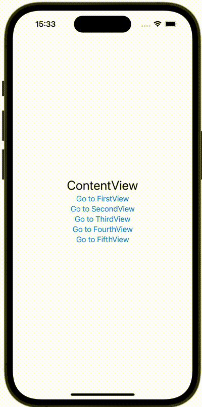

+++
title = "NavigationStackのpathを使って画面遷移する"
url = "2023-12-15"
date = "2023-12-15"
description = "NavigationStackのpathを使って画面遷移する"
tags = ["Swift", "SwiftUI"]
categories = ["SwiftUI"]
archives = "2023/12"
+++

<br>

NavigationStackのpathを使って画面遷移する方法です。



<!--more-->

**ContentView.swift**

```swift
import SwiftUI

struct ContentView: View {
    @State var path: [ViewPath] = []

    var body: some View {
        NavigationStack(path: $path) {
            VStack {
                Text("ContentView")
                    .font(.title)

                NavigationLink(value: ViewPath.firstView) {
                    Text("Go to FirstView")
                }

                NavigationLink(value: ViewPath.secondView) {
                    Text("Go to SecondView")
                }

                NavigationLink(value: ViewPath.thirdView) {
                    Text("Go to ThirdView")
                }

                NavigationLink(value: ViewPath.fourthView) {
                    Text("Go to FourthView")
                }

                NavigationLink(value: ViewPath.fifthView) {
                    Text("Go to FifthView")
                }
            }
            .navigationDestination(for: ViewPath.self) { pathValue in
                switch pathValue {
                case .firstView:
                    FirstView(path: self.$path)
                case .secondView:
                    FirstView(path: self.$path)
                case .thirdView:
                    ThirdView(path: self.$path)
                case .fourthView:
                    FourthView(path: self.$path)
                case .fifthView:
                    FifthView(path: self.$path)
                }
            }
        }
    }
}
```

