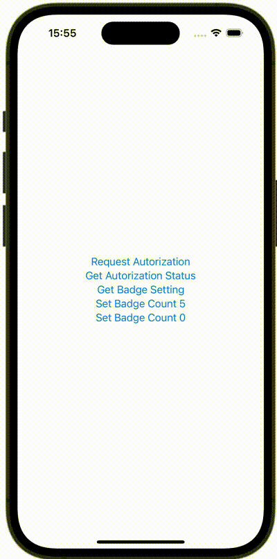

+++
title = "SwiftUIでBadgeを表示する"
url = "2023-12-16"
date = "2023-12-16"
description = "SwiftUIでBadgeを表示する"
tags = ["Swift", "SwiftUI"]
categories = ["SwiftUI"]
archives = "2023/12"
+++

<br>

SwiftUIでBadgeを表示する方法です。



<!--more-->

**ContentView.swift**

```swift
import SwiftUI

struct ContentView: View {
    @State var message = ""
    @State var showingAlert = false
    var body: some View{
        VStack {
            Button {
                Task {
                    do {
                        let options: UNAuthorizationOptions = [.badge]
                        try await UNUserNotificationCenter.current().requestAuthorization(options: options)
                    } catch {
                        print(error)
                    }
                }
            } label: {
                Text("Request Autorization")
            }

            Button {
                Task { @MainActor in
                    let settings = await UNUserNotificationCenter.current().notificationSettings()
                    switch settings.authorizationStatus {
                    case .notDetermined:
                        print("NotDetermined")
                        message = "NotDetermined"
                    case .denied:
                        print("Denied")
                        message = "Denied"
                    case .authorized:
                        print("Authorized")
                        message = "Authorized"
                    case .provisional:
                        print("Provisional")
                        message = "Provisional"
                    case .ephemeral:
                        print("Ephemeral")
                        message = "Ephemeral"
                    @unknown default:
                        print("default")
                        message = "default"
                    }

                    showingAlert = true
                }
            } label: {
                Text("Get Autorization Status")
            }

            Button {
                Task { @MainActor in
                    let settings = await UNUserNotificationCenter.current().notificationSettings()
                    switch settings.badgeSetting {
                    case .notSupported:
                        print("NotSupported")
                        message = "NotSupported"
                    case .disabled:
                        print("Disabled")
                        message = "Disabled"
                    case .enabled:
                        print("Enabled")
                        message = "Enabled"
                    @unknown default:
                        print("default")
                        message = "default"
                    }
                    showingAlert = true
                }
            } label: {
                Text("Get Badge Setting")
            }

            Button {
                Task { @MainActor in
                    do {
                         try await UNUserNotificationCenter.current().setBadgeCount(5)
                    } catch {
                        print(error)
                        message = error.localizedDescription
                        showingAlert = true
                    }
                }
            } label: {
                Text("Set Badge Count 5")
            }

            Button {
                Task { @MainActor in
                    do {
                         try await UNUserNotificationCenter.current().setBadgeCount(0)
                    } catch {
                        print(error)
                        message = error.localizedDescription
                        showingAlert = true
                    }
                }
            } label: {
                Text("Set Badge Count 0")
            }
        }
        .alert("", isPresented: $showingAlert) {
        } message: {
            Text(message)
        }
    }
}
```

