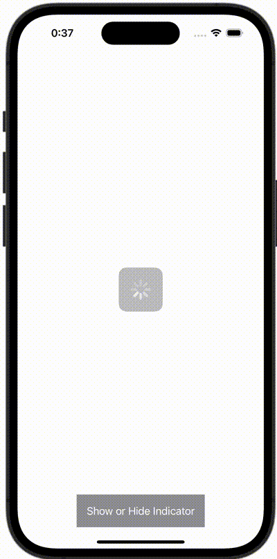

+++
title = "SwiftUIで少しカスタマイズしたインディケーターを表示する"
url = "2023-12-22"
date = "2023-12-22"
description = "SwiftUIで少しカスタマイズしたインディケーターを表示する"
tags = ["Swift", "SwiftUI"]
categories = ["SwiftUI"]
archives = "2023/12"
+++

<br>

SwiftUIで少しカスタマイズしたインディケーターを表示する方法です。



<!--more-->

**ContentView.swift**

```swift
import SwiftUI

struct ContentView: View {
    @State var showingIndicator = true
    
    var body: some View {
        ZStack {
            VStack {
                Spacer()
                Button {
                    showingIndicator.toggle()
                } label: {
                    Text("Show or Hide Indicator")
                        .foregroundColor(Color.white)
                        .padding()
                        .background(Color.gray)
                        .clipped()
                }
            }
            
            if showingIndicator {
                ProgressView()
                    .progressViewStyle(.circular)
                    .padding(12)
                    .tint(Color.white)
                    .background(Color.gray.opacity(0.6))
                    .cornerRadius(8)
                    .scaleEffect(1.6)
            }
        }
    }
}
```

