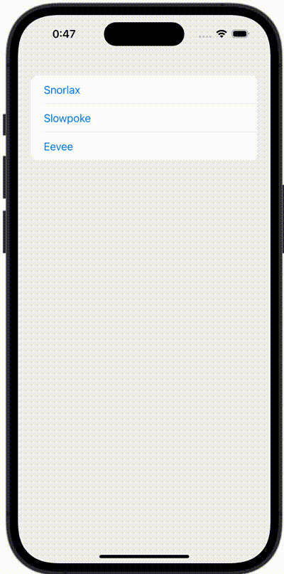

+++
title = "SwiftUIでListにButtonを設定して異なる画面に遷移する"
url = "2023-12-23"
date = "2023-12-23"
description = "SwiftUIでListにButtonを設定して異なる画面に遷移する"
tags = ["Swift", "SwiftUI"]
categories = ["SwiftUI"]
archives = "2023/10"
+++

<br>

SwiftUIでListにButtonを設定して異なる画面に遷移する方法です。



<!--more-->

**ContentView.swift**

```swift
import SwiftUI

struct ContentView: View {
    @State var pokemon: Pokemon?
    
    var body: some View {
        NavigationStack {
            List {
                Button {
                    pokemon = .snorlax
                } label: {
                    Text("Snorlax")
                }
                Button {
                    pokemon = .slowpoke
                } label: {
                    Text("Slowpoke")
                }
                Button {
                    pokemon = .eevee
                } label: {
                    Text("Eevee")
                }
            }
            .navigationDestination(item: $pokemon) { pokemon in
                switch pokemon {
                case .snorlax:
                    VStack {
                        Image(.snorlax)
                        Text("Snorlax")
                    }
                case .slowpoke:
                    Text("Slowpoke")
                case .eevee:
                    Image(.eevee)
                }
            }
        }
    }
}
```


**Pokemon.swift**

```swift
import SwiftUI

enum Pokemon: Hashable {
    case snorlax
    case slowpoke
    case eevee
}
```

