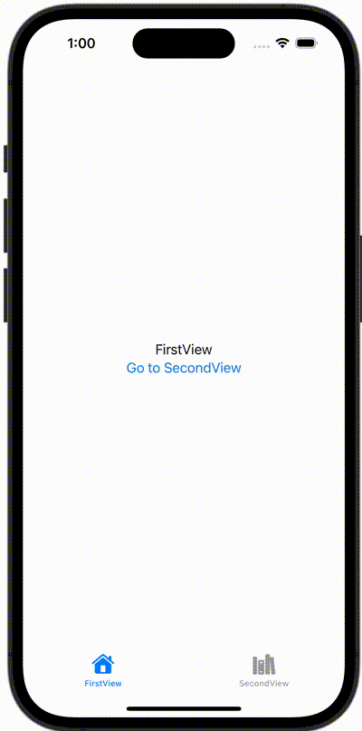

+++
title = "SwiftUIのTabViewのタブをコードから動的に切り替える"
url = "2023-12-24"
date = "2023-12-24"
description = "SwiftUIのTabViewのタブをコードから動的に切り替える"
tags = ["Swift", "SwiftUI"]
categories = ["SwiftUI"]
archives = "2023/12"
+++

<br>

SwiftUIのTabViewのタブをコードから動的に切り替える方法です。



<!--more-->

**ContentView.swift**

```swift
import SwiftUI

struct ContentView: View {
    @State var selection: Int = 0
    
    var body: some View {
        TabView(selection: $selection) {
            FirstView(selection: $selection)
                .tabItem {
                    Image(systemName: "house")
                        .renderingMode(.template)
                    Text("FirstView")
                }
                .tag(0)
            SecondView(selection: $selection)
                .tabItem {
                    Image(systemName: "books.vertical")
                        .renderingMode(.template)
                    Text("SecondView")
                }
                .tag(1)
        }
    }
}
```


**FirstView.swift**

```swift
import SwiftUI

struct FirstView: View {
    @Binding var selection: Int
    var body: some View {
        VStack {
            Text("FirstView")
            Button {
                selection = 1
            } label: {
                Text("Go to SecondView")
            }
        }
    }
}
```


**SecondView.swift**

```swift
import SwiftUI

struct SecondView: View {
    @Binding var selection: Int
    var body: some View {
        VStack {
            Text("SecondView")
            Button {
                selection = 0
            } label: {
                Text("Go to FirstView")
            }
        }
    }
}
```

