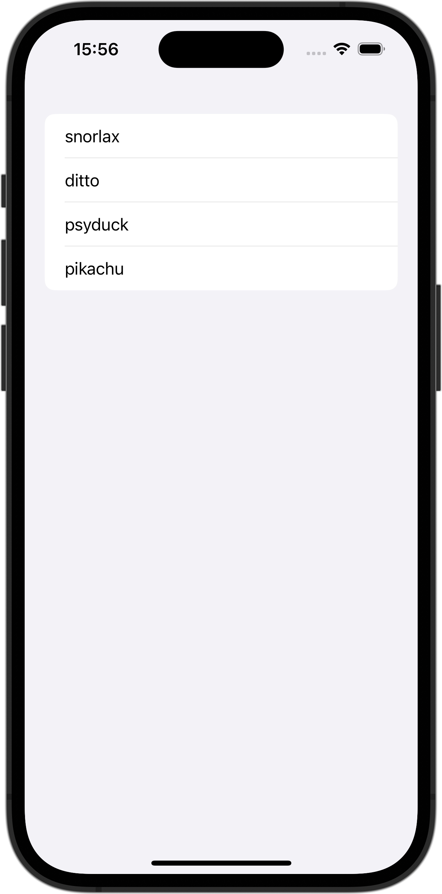

+++
title = "Identifiableに適合していないStructでListを使う"
url = "2023-12-25"
date = "2023-12-25"
description = "Identifiableに適合していないStructでListを使う"
tags = ["Swift", "SwiftUI"]
categories = ["SwiftUI"]
archives = "2023/12"
+++

<br>

Identifiableに適合していないStructでListを使う方法です。



<!--more-->

**ContentView.swift**

```swift
import SwiftUI

struct ContentView: View {
    let pokemons: [Pokemon] = [
        Pokemon(name: "snorlax", type: "normal"),
        Pokemon(name: "ditto", type: "normal"),
        Pokemon(name: "psyduck", type: "water"),
        Pokemon(name: "pikachu", type: "electric"),
    ]
    
    var body: some View {
        List {
            ForEach(0..<pokemons.count, id: \.self) { index in
                Text("\(pokemons[index].name)")
            }
        }
    }
}
```


**Pokemon.swift**

```swift
import SwiftUI

struct Pokemon {
    let name: String
    let type: String
}
```


