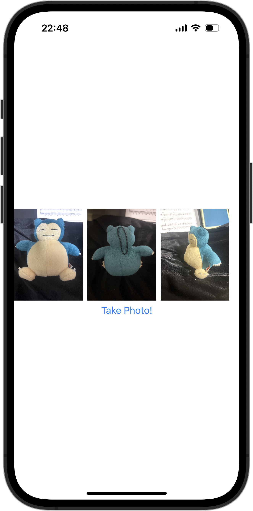

+++
title = "SwiftUIでカメラを使う"
url = "2023-12-26"
date = "2023-12-26"
description = "SwiftUIでカメラを使う"
tags = ["Swift", "SwiftUI"]
categories = ["SwiftUI"]
archives = "2023/12"
+++

<br>

SwiftUIでカメラを使う方法です。
カメラを利用できるViewを作成し、sheetで表示しています。
権限の追加も必要です。



<!--more-->

**CameraView.swift**

```swift
import SwiftUI

public struct CameraView: UIViewControllerRepresentable {
    @Environment(\.dismiss) private var dismiss
    @Binding var images: [UIImage]

    public func makeCoordinator() -> Coordinator {
        Coordinator(self)
    }

    public func makeUIViewController(context: Context) -> UIImagePickerController {
        let viewController = UIImagePickerController()
        viewController.delegate = context.coordinator
        if UIImagePickerController.isSourceTypeAvailable(.camera) {
            viewController.sourceType = .camera
        }

        return viewController
    }
    public func updateUIViewController(_ uiViewController: UIImagePickerController, context: Context) {}
}

extension CameraView {
    public class Coordinator: NSObject, UIImagePickerControllerDelegate, UINavigationControllerDelegate {
        let parent: CameraView

        init(_ parent: CameraView) {
            self.parent = parent
        }

        public func imagePickerController(_ picker: UIImagePickerController, didFinishPickingMediaWithInfo info: [UIImagePickerController.InfoKey: Any]) {
            if let uiImage = info[.originalImage] as? UIImage {
                self.parent.images.append(uiImage)
            }
            self.parent.dismiss()
        }

        public func imagePickerControllerDidCancel(_ picker: UIImagePickerController) {
            self.parent.dismiss()
        }
    }
}
```


**ContentView.swift**

```swift
import SwiftUI

struct ContentView: View {
    @State var images: [UIImage] = []
    @State var showingSheet = false
    
    var body: some View {
        VStack {
            ScrollView(.horizontal) {
                HStack {
                    ForEach(0..<images.count, id: \.self) { index in
                        Image(uiImage: images[index])
                            .resizable()
                            .aspectRatio(contentMode: .fit)
                            .frame(height: 160)
                            .clipped()
                    }
                }
            }
            
            Button {
                showingSheet = true
            } label: {
                Text("Take Photo!")
            }
        }
        .sheet(isPresented: $showingSheet) {
            CameraView(images: $images)
        }
    }
}
```

